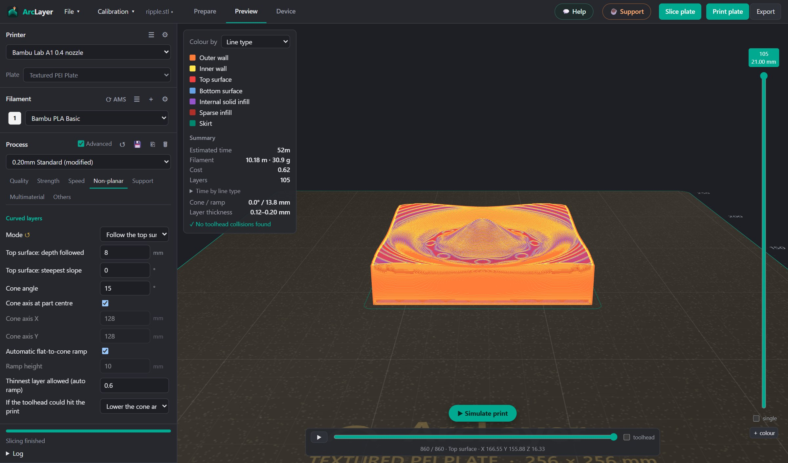
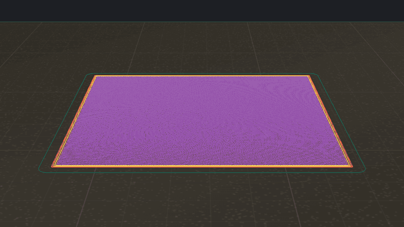

<p align="center"></p>

<p align="center"><b>A free slicer that prints curved layers on the 3D printer you already have.</b><br>
No hardware mods, no scripts: load a model, press Slice, print.</p>

<p align="center">
  <a href="https://github.com/giwrgosgeo97/arclayer/releases/latest"><b>⬇ Download for Windows</b></a> ·
  <a href="#what-it-does">What it does</a> ·
  <a href="#printers">Printers</a> ·
  <a href="https://ko-fi.com/georgies">☕ Support on Ko-fi</a>
</p>



## What it does

Normal slicers cut a model into flat layers. ArcLayer bends them:

- **Follow the top surface**: the last layers follow the shape of the top, so domes, waves and slopes come out smooth instead of stair-stepped.
- **Conical layers**: the layers are shallow cones, so steeper overhangs print **without support**.
- **Collision check**: the printing moves are checked against a simple model of your toolhead (the nozzle cone and a disc for the heater block, with sizes you can set). If that could touch an earlier layer, ArcLayer lowers the curve and slices again, or warns you. It doesn't know your fan duct, cables or clips and doesn't check travel moves, so look at the preview and watch the print.

The rest of a modern slicer is there too: an Orca-style interface, presets for **100+ printers** with their makers' own start G-code, multi-colour (AMS, CFS and M600 filament changes), tree and normal supports, 16 infill patterns, calibration prints, print by object with collision warnings, auto arrange, and sending straight to Bambu Lab, Prusa, Klipper/Moonraker and OctoPrint printers (tested on a Bambu Lab A1; the others so far only against test servers) with a live camera view.



**Status:** experimental and free. Tested with real prints on a Bambu Lab A1. The other printers are set up from their makers' profiles but have had less real-world testing, so watch the first layers. See [DISCLAIMER.md](DISCLAIMER.md). For problems and ideas, use File → **Report a problem** in the app, or open an issue here.

**Install:** download `ArcLayer-Setup-<version>.exe` from [Releases](https://github.com/giwrgosgeo97/arclayer/releases/latest) and run it (Windows 10/11, 64-bit, no admin rights). It isn't code-signed yet, so Windows may say "Windows protected your PC": click **More info**, then **Run anyway**. ArcLayer checks for updates once a day.

**Support:** ArcLayer has no ads, no account and no paid version. If it saves you a print, [a coffee on Ko-fi](https://ko-fi.com/georgies) helps a lot. Supporters get a code that hides the reminder window.

*Formerly NonPlanar Slicer.* Installing ArcLayer over it copies your presets, printers and settings from `%APPDATA%\NonPlanar Slicer` to `%APPDATA%\ArcLayer` (the old folder is kept as a backup).

## License

ArcLayer is free software under the [GNU AGPL-3.0](LICENSE). The printer start/end G-code comes from the public profiles of OrcaSlicer and Bambu Studio (also AGPL-3.0).

## The app

The first start shows a short **intro** (File → Show the intro brings it back). The **💬 Help** button in the top bar is a helper that answers questions about the app, every setting and every calibration, and opens the setting it talks about. It runs inside the app, without internet (`app/ui/help.js` holds its topics).

- **Report a problem** (File menu, or the helper): makes `Documents\ArcLayer\reports\ArcLayer-report-<time>.zip` (what happened, the end of the app log, the settings in use, a picture of the plate) and opens an email in the person's own mail app. IP addresses, serial numbers, access codes, API keys, passwords, camera logins, e-mail addresses and the Windows user name are removed first. Set the address in `REPORT_EMAIL` (`app/report.py`).
- **Updates**: once a day the app asks GitHub for the latest release (`app/updates.py`) and shows a bar with a Download button; File → Check for updates checks now.
- **Prime tower** (Process → Multimaterial): for several filaments on printers without a purge chute (Auto leaves it off on Bambu printers). It is printed in flat layers that follow the lowest point of each curved layer, so it is never taller than the part, and the nozzle always goes above everything printed before travelling to or from it.
- **Print by object** (Process → Others → Print sequence): each object (the separate parts of the model) is printed to the top before the next, each with its own curved layers (`nonplanar/sequence.py`). Lowest first, tallest last; the nozzle goes up above everything printed before moving to the next object, and filament-change macros get that height too. The slice summary warns when objects are closer than the toolhead radius or when an object that isn't last is taller than the gantry. Both numbers are in Printer settings → Toolhead clearance, filled in from OrcaSlicer's printer profiles (`nonplanar/clearance.json`).
- **Auto arrange** (⊞ Arrange above the plate, or A): spreads the parts over the plate, biggest first, compact and centred (`nonplanar/arrange.py`). The gap is 6 mm plus the brim when printing by layer, and the toolhead clearance radius when printing by object. Parts that touch stay together, and each group is set down on the plate.
- **Supports** are made in the bent space, so they print on the same curved layers as the model. Their XY gap applies to walls only; under a curved underside the Z gap sets the distance.
- **Remembered choices** (last presets, filament slots, tabs, cameras) are kept in `ui_state.json` in the data folder.
- **Supporter codes**: the app holds only slow hashes of the valid codes (`app/supporter_hashes.py`), so no code can be made from it. `make_supporter_code.py` makes new ones; the codes themselves are in `supporter_codes.txt`, which is neither in git nor in the installer.

Double-click **`ArcLayer.bat`**. The first start installs the Python libraries it needs.

Laid out like Orca Slicer:
- **Prepare**: import a model (drag and drop, or Import), then move, scale or rotate it on the plate. The dashed teal line is the cone axis.
  The tool bar on the left of the plate has:
  - **Move (M)**: drag the arrows, or type X / Y.
  - **Rotate (R)**: drag the rings, or turn ±90° around X or Y.
  - **Scale (S)**: percent, or a size in mm.
  - **Lay on face (F)**: click a flat face to put it down on the plate.
  - **Paint support (L)**: green (enforce) adds support where you paint, even with support switched off; red (block) never gets support. Shift-drag erases. The first time you paint, big triangles are split into small ones (same shape) so the brush can paint small areas.
  Rotation and painting are saved in the project.

## Print settings

- **Support** (Support tab): **Normal** (Default or Grid style) or **Tree** (Slim, Strong, Hybrid, Organic). Tree
  branches start on a grid under each overhang, lean together (at most the branch angle), merge, thicken going down and
  steer around the part; Hybrid uses normal columns under big flat areas. Also: bottom Z distance and bottom interface
  layers (where support stands on the part), support walls, base patterns Rectilinear / Rectilinear grid / Honeycomb /
  Hollow, interface patterns Rectilinear / Grid / Concentric, and the tree branch angle, distance, diameters.
- **Infill** (Strength tab): 16 sparse patterns: Rectilinear, Aligned Rectilinear, Line, Grid, Triangles, Tri-hexagon,
  Stars, Cubic, Cross Hatch, Gyroid, Honeycomb, 3D Honeycomb, Lightning (only holds up the top surfaces), Hilbert Curve,
  Archimedean Chords, Concentric. Top/bottom surfaces add Hilbert Curve and Archimedean Chords. Also solid infill every
  N layers and an alternate extra wall.
- **Others**: fuzzy skin (outer or all walls), mouse-ear brims, ironing angle.

## Choosing your printers and filaments

On the first start a window asks in two steps which printers (**Next**) and then which filaments (**Done**) you use;
only those show in the lists on the left (your own saved presets always show). Change it any time with **☰** on the
Printer or Filament card, or **File → Printers & filaments…**. Each step has a search box, a brand list, and Select
all / Clear.

Each printer card has a drawing of that kind of printer (bed slinger, one-arm, open cube or enclosed) and nozzle
chips: tick a card for the 0.4 mm nozzle, or pick 0.2 / 0.4 / 0.6 / 0.8. Every printer has all four nozzle presets.
A photo named like the printer model (for example `Prusa MK4.jpg`) in `%APPDATA%\ArcLayer\printer_images`
is shown instead of the drawing.

## Filaments

93 filament presets, grouped by brand: Generic presets for 18 materials (PLA, PLA+, Silk, Matte, PLA-CF, PETG, PETG-CF,
PCTG, ABS, ASA, TPU, PC, PA, PA-CF, PET-CF, HIPS, PVA, PP) and brand filaments from Bambu Lab, Polymaker, Prusament,
eSUN, Sunlu, Elegoo, Creality, Overture, Hatchbox and others (`app/filaments.py`). Temperatures, fan, max volumetric
speed and pressure advance are starting values from the makers' ranges: tune them with the Calibration menu.
Carbon fibre (-CF) filaments need a hardened nozzle.

## Printers

- **Speed**: the built-in processes use Bambu's speeds (outer wall 200, inner wall 300, sparse infill 270 mm/s at
  0.20 mm Standard). Each printer has a **Speed limit** (Printer settings → Basic information) that caps them: 100 % for
  Bambu and Klipper printers, about 70 % for a Prusa MK4, about 35 % for an Ender-3 class printer.

Over 100 printers are built in, grouped by brand in the Printer list: Bambu Lab, Prusa, Creality, Anycubic, Elegoo,
Sovol, Voron, RatRig, Qidi, Artillery, Flashforge, Anker, Snapmaker and more (`app/printers.py`), plus two Custom presets
to start your own from. Each has its bed size, height, retraction (Bowden or direct drive) and a generic start G-code.
Bambu printers print over the network with a template; for the others, **Save G-code** and print it from USB / SD or
the printer's web page. If your printer has its own start macro, paste it under Printer settings → Machine G-code.
- **Sync with my other PCs** (File menu): pick the same OneDrive / Google Drive / Dropbox folder on each PC and your
  presets and app settings stay the same everywhere. No account. The newer change wins; deletions sync too.
- **File menu** (top left): New project (Ctrl+N), Open project (Ctrl+O), recent files, Save project (Ctrl+S),
  Save project as (Ctrl+Shift+S), Import model (Ctrl+I), Export plate sliced file (Ctrl+G) and Export G-code.
  A project is a normal `.3mf`: Bambu Studio and Orca open its model, and this app also restores the presets and
  their unsaved changes, filament slots and colours, part colours, colour changes and placement. Your printer's
  IP address, serial number, access code and template stay out of project files. Closing the window or opening
  another file with unsaved changes asks **Save / Don't save / Cancel**. A `.3mf` from another program is imported
  as a model, and Save asks for a new file name so the original is never overwritten.
- **Opening files from Explorer**: setup can make `.3mf` and `.stl` open in the app (double-click, or Open with).
  If another app is already your choice for a type, Windows lets only you change it: setup opens
  Settings → Default apps, where you click `.3mf` / `.stl` and pick ArcLayer. A file opened while the app is
  running goes to the open window.
- **Calibration menu** (top left), after Orca's calibration guide. Each test opens a dialog with its range
  (defaults for the selected filament type and nozzle), then **Create and slice** builds the test print, slices it
  with flat layers and the settings the test needs, and shows it in Preview, ready to print from the Device tab.
  A panel explains how to read the print; pick the best block/height there and **Apply** writes the result into
  the filament (or printer / process) preset, then 💾 saves it.
  - Filament: **Temperature tower** (10 mm blocks with overhang, bridge and the temperature embossed on the side),
    **Flow rate** (coarse ±20 %, fine ±5 %, YOLO 0.5 % blocks, numbered), **Pressure advance** as **line**, **pattern**
    (numbered chevrons) or **tower**, **Retraction** (two towers, +step every 1 mm), **Max volumetric speed**
    (one-wall box, flow rising every 1 mm; 85 % of the failing flow is applied), **First layer** (one-layer squares
    with the first-layer flow change cut into each), **Top surface flow** (only the tops change) and **Ironing**
    (ironing flow per block).
  - Non-planar: **wavy cup** (printed in the *Follow the top surface* mode: the last lines run along the wavy rim).
  - Advanced: **VFA** speed tower (speed every 5 mm) and **Tolerance** (six hex holes 0–0.3 mm clearance and a peg).
  - Cornering, input shaping and adaptive PA are listed but not available: Bambu firmware handles those itself.
    Device → Send print has **Flow dynamics calibration** and **Vibration compensation** to let a Bambu printer run its own.
  - Calibration prints print in one filament (the selected slot).
- **Nozzles and layer heights**: the A1 and A1 mini come with 0.2, 0.4, 0.6 and 0.8 mm nozzle presets; every other printer starts at 0.4 mm (change it under Printer settings).
  The process list shows only the presets made for the printer's nozzle, with Orca's layer heights
  (0.4 mm: 0.08, 0.12, 0.16, 0.20, 0.24, 0.28; 0.2 mm: 0.06–0.14; 0.6 mm: 0.18–0.42; 0.8 mm: 0.24–0.56) and line widths
  scaled to the nozzle. The layer height field offers the common values in a drop-down list. Use a Bambu template
  sliced for the same nozzle size.
- **Sidebar**: printer, filament and process presets. The ⚙ button edits a preset, ＋ adds a filament, 💾 saves and ⎘ saves as a new preset.
  Process tabs: **Quality · Strength · Speed · Non-planar · Support · Others**.
  Support is checked against the curved layers, so overhangs the cone already handles get none.
  The settings follow Orca's layout and names. Tick **Advanced** in the Process header to see every option. Included:
  line widths per feature, seam position, X-Y hole and contour compensation, elephant foot compensation, ironing,
  wall order, one wall on top surfaces, bridge flow, overhang slow-down in 4 tiers, top and bottom shell thickness and
  patterns, 8 infill patterns (rectilinear, aligned, grid, triangles, cubic, gyroid, honeycomb, concentric),
  acceleration per feature, slow layers, small perimeters, Orca-style fan and layer-cooling logic, pressure advance,
  brim types, skirt height and reduce infill retraction.
  Not done yet: tree supports, the Arachne wall generator, lightning and adaptive infill, fuzzy skin,
  and gap fill.
  **Reset:** a changed setting shows ↺, which puts back the preset's value. The Process ↺ button and the editor's
  **Reset changes** undo all unsaved changes; **Restore defaults** puts a built-in preset back to factory values
  (the printer's connection details and template are kept).
- **Multicolour on other brands**: each printer uses its maker's own filament-change sequence: Creality CFS
  (K1C / K2 / Hi) and Anycubic ACE swap on `T`, Qidi Box and Elegoo Centauri Carbon run their own macros, and
  single-nozzle printers without a filament system pause for a manual swap (`M600`). There is no prime tower yet.
- **AMS lite (multi-colour)**: up to 4 filament slots in the Filament card (＋ adds one). Click a slot's number to pick
  its colour from the palette (or type a hex code). **⟳ AMS** loads the filaments and colours actually in your AMS lite.
  Colour the model two ways:
  - **By part**: a 3MF with several objects, or an STL with separate pieces, shows its parts in the Objects list.
    Click a part (in the list or on the plate) and press 1–4. Where parts overlap, the smaller one wins (inlays, text).
  - **By height**: in Preview, move the layer slider and press **＋ colour**: from that layer up, the model prints
    in that filament.
  The **Multimaterial** process tab sets a fixed filament for walls, infill, solid infill and supports, and the flush
  multiplier. Preview can colour lines by **Filament**, with usage per filament, number of changes and flush waste.
  Filament changes use the change G-code from your Bambu template (the printer's own cut-and-flush sequence), so **set a
  template before printing in more than one colour**. Without one, a generic change is used that doesn't flush.
  No prime tower yet. `models/two_colour.stl` is a small 3-part test model.
- **Slice plate**: then **Preview** shows the curved toolpaths, with a layer slider, line types you can toggle, time and filament estimates, and the collision check result.
  **Colour by** (top left) colours the toolpaths by line type, filament, speed, volumetric flow, line width, layer
  height (shows how the curved layers thin out), layer time, fan speed, temperature, acceleration or pressure advance.
  The summary shows the cost and **Time by line type**, and says how much time cooling slow-downs and the filament's
  max volumetric speed add.
  **▶ Simulate print** plays the whole print with the toolhead, from the first layer to the last: pause (Space),
  drag the bar to jump anywhere, pick the speed (1× real time up to 5000×), and tick **follow** to have the camera
  follow the nozzle. The clock uses each move's real speed, scaled to the print-time estimate.
  The slider along the bottom plays one layer from its first move to its last (▶ or Space, ← → to step, Shift for 10),
  with the nozzle and heater block drawn at the current point (sizes from Printer settings → Toolhead clearance).
  Red dots mark where the collision check found the head too close to the print; the block turns red there, and
  **Show** on the warning jumps to the worst one. If a collision is found, the cone angle is lowered automatically
  (Non-planar → "If the toolhead could hit the print").
- **Plate** (under Printer): Textured PEI, Cool, Engineering, High Temp or Cool SuperTack. It sets the bed
  temperature for the plate (for example 35 °C for PLA on the Cool Plate), tells the printer which plate to expect,
  and is drawn on the 3D plate together with mm rulers along the front and right edges.
- **Export**: saves to the `output/` folder (a `.gcode.3mf` for the A1 / A1 mini, or when a Bambu template is set).
- **Device**: connects to your printers over your home network: Bambu (LAN), **Klipper** (Moonraker: Creality K1 / K2 /
  Hi, Voron, Sovol, Elegoo Neptune 4, Qidi…), **OctoPrint** and **PrusaLink** (Printer settings → Connection). Upload &
  print, status, pause / stop, temperatures, speed and the printer's camera (Bambu, Klipper and OctoPrint).
  - **Several printers**: make a printer preset for each (⚙ → Save as…, e.g. "A1 #2") with its own connection, and
    connect to each. They stay connected; the bar at the top of the Device tab switches between them.
  - Status, progress, layer and **time left** (the file carries Bambu's time and layer header, so the printer shows them too).
  - Pause, resume, stop, the light, and the **speed** (Silent / Standard / Sport / Ludicrous) like the printer's speed button.
  - **Temperatures while printing**: type a nozzle or bed temperature and press Enter, or use −5 / −1 / +1 / +5.
  - **Live view**: the print you sent, in 3D, following the printer: the layers done and the layer being printed drawn
    up to where the nozzle is now (estimated from the time), with progress, time left and the printer camera.
  - **Cameras**: the printer's own camera (turn on *LAN Only Liveview* on the printer) and **your own camera**.
    For a **Tapo**: in the Tapo app open the camera → ⚙ Settings → Advanced Settings → **Camera Account** and make a user
    name and password (a login only for the camera, not your Tapo account, and not *Share*); on newer firmware also turn
    on Me → Tapo Lab → Third-Party Compatibility. Then ⚙ Set up → Tapo camera: **Find** looks for it on your network,
    fill in the user name and password, **Test**, **Save**. Any other RTSP / HTTP camera: *Other camera*.
  - **Send print**: pick which AMS slot (or the external spool) prints each filament; the choices and the ticks
    (bed levelling, timelapse, flow and vibration calibration, Quick start) are remembered.
    *Flow dynamics calibration* and *Vibration compensation* only need to run once (per filament, or after moving the
    printer): the printer keeps the result, so turn them off afterwards. *Quick start* skips the start-up tune and the
    motor noise check (the printer uses its saved values); the heat-up and cool-down steps stay, because the nozzle has
    to be hot to wipe and purge but cool (140 °C) to probe the bed accurately.
  - The app reconnects to the printer by itself when you start it again (also after an update), until you press Disconnect.
  - **When a spool runs out** (AMS card): *Pause and wait* (Bambu's default), *Printer's auto refill* (the printer
    switches to a slot with the same filament by itself), or *Switch slots in my order*, e.g. `1>3>4>2` or `3>2>1>4`:
    the app loads the next slot in your order that has filament and resumes. The app must stay open (minimised is fine).
  - The file shows a picture of the print on the printer's screen (in the place Bambu Studio's picture goes).

### Connecting a Bambu printer
In the printer settings (⚙ next to Printer), open the **Connection** tab and fill in the printer's IP address, serial
number and access code (all shown on the printer's screen under Settings). The access code stays on this computer, in
`profiles/printer/*.json`. On newer firmware, turn on **LAN Only** and **Developer Mode** on the printer to let
third-party apps control it.

### Every printer starts the way its own slicer would
Each built-in printer uses its maker's real start and end G-code, filled in with this print's values: a Prusa does its
nozzle and model checks, mesh levelling over the print area and purge line; a Voron, Sovol or Creality K1 calls its
`PRINT_START` / `START_PRINT` macro; an Ender-3 heats, homes and draws its purge line; and so on. They come from the
public printer profiles of **OrcaSlicer** and **Bambu Studio** (AGPL-3.0), kept in `nonplanar/printer_gcode.json`
(and `nonplanar/bambu_gcode/` for the A1 and A1 mini). The Generate log says which one a slice used.

- **Bambu printers** (A1, A1 mini, P1P, P1S, P2S, X1 Carbon, X1E, H2D) print over the network with no template: the
  slicer builds the `.gcode.3mf` itself, with the printer's model code, Bambu's filament-change sequence for the AMS
  and a thumbnail for the printer's screen. The camera works on all of them (port 6000 on A1 / P1, RTSP on X1 / H2D).
- **If you change a printer's start G-code** (Printer settings → Machine G-code), yours is used instead.
- **A Bambu template** still overrides everything, if you want your own exported sequence: in Bambu Studio or Orca,
  slice any small model, **File → Export → Export plate sliced file**, and pick that file under printer settings →
  **Machine G-code** → Template.
- The CR-10 S5, Mingda Magician X2 and the two Custom printers have no maker profile: they use a generic start
  (heat, home, purge line). Paste your own start G-code there if your printer needs bed levelling or a start macro.
- Only the A1 has been tried on a real printer so far.

Presets live in `profiles/`, and model and output files in `workspace/` and `output/`.

### Building the installer
```bash
python -m pip install pyinstaller==6.16.0
python build_installer.py
```
This builds `dist/ArcLayer-Setup-<version>.exe`, about 83 MB. That single file is what you share. It installs per user with no admin rights, to
`%LOCALAPPDATA%\Programs\ArcLayer`. It adds a Start Menu shortcut and an optional Desktop shortcut, and it shows up in Windows'
**Installed apps** with an uninstaller. The installed app keeps presets in `%APPDATA%\ArcLayer` and exports to
`Documents\ArcLayer`. Set the version at the top of `build_installer.py`.

The exe isn't code-signed, so Windows SmartScreen shows "Windows protected your PC" on first run. Click **More info → Run anyway**.

---

## Command line (same engine)
Version 0.1, conical mode. The layers are cones instead of flat sheets, so parts that
flare outward (mushrooms, cups, overhangs up to roughly 55–60°) print **without supports**.

## How it works

Two non-planar modes (Process → Non-planar → Mode):
- **Conical (overhangs)**: every layer is a cone around an axis, so outward (or inward) overhangs print without support.
- **Follow the top surface**: the lower layers are flat and the top layers bend to the shape of the model's top, so
  wavy rims, domes and sculpted tops print as smooth curved lines instead of stair steps. Slopes steeper than the
  toolhead clears (Printer settings → Toolhead clearance) are smoothed; *depth followed* and *steepest slope* tune it.

1. **Bend** the model so the cone-shaped layers become flat.
2. **Slice** the bent model with normal flat layers (walls, top/bottom skin, infill).
3. **Bend back** the toolpaths, so each flat layer becomes a curved 3D path.

Extrusion is computed for each segment from the true local layer thickness, so the
curved layers get the right amount of plastic. Near the bed the layers start flat
(full first-layer contact) and bend into the cone over a "ramp" height that's chosen automatically.

## Setup (one time)

```bash
python -m pip install -r requirements.txt   # the .bat does this for you
```

## Use

```bash
python make_test_models.py
python -m nonplanar models/overhang_cup.stl --angle 15
```

You get:
- `*_nonplanar.gcode`: the toolpaths
- `*_nonplanar_preview.html`: a 3D preview. Open it in a browser and use the slider to step through layers.

### Printing on a Bambu printer (important)

Bambu printers need Bambu's own start sequence (homing, bed levelling, nozzle wipe) and a
`.gcode.3mf` file. Here's the way to get both:

1. In Bambu Studio or OrcaSlicer, slice **any** small model for your printer with the
   filament and plate you'll use, then **File → Export → Export plate sliced file**.
   Save it, for example as `a1_template.gcode.3mf`.
2. Run:
   ```bash
   python -m nonplanar mymodel.stl --angle 15 --template a1_template.gcode.3mf
   ```
3. Print the resulting `mymodel_nonplanar.gcode.3mf` from the SD card.

Without `--template`, the start G-code is a generic placeholder. **Don't print that on a Bambu printer.**

## Options

| Option | Meaning |
|---|---|
| `--angle 15` | Cone angle. `+` handles outward overhangs, `-` inward overhangs. Start with 10–15. |
| `--center X Y` | Cone axis on the bed (default: centre of the part) |
| `--ramp 10` | Height over which layers go from flat to conical (default: auto) |
| `--layer 0.2` `--walls 3` `--infill 0.15` | The usual settings |
| `--support` / `--support-plate-only` | Supports for what the cone can't print (flat undersides, bridges) |
| `--config settings.json` | All settings (copy `settings.example.json`) |

## Collision check: measure your hotend

With curved layers, material that's already printed can sit **higher than the nozzle tip**
right next to where it's printing. The checker warns when the hotend could hit the print.
It uses these settings, which are **estimates, not measured values for your hotend**:

- `nozzle_free_height` (3.0 mm): how far the nozzle tip sticks out below the heater block or silicone sock
- `head_radius` (12 mm): how far the block or sock reaches sideways from the nozzle
- `nozzle_cone_slope` (1.2): steepness of the brass nozzle cone

Measure your toolhead and put the real numbers in a config file. A rough rule:
`tan(angle) × head_radius` must stay below `nozzle_free_height`.

## Roadmap

- [x] Conical layers, flat-to-cone ramp, per-segment flow, travel lift, collision check, Bambu 3MF
- [ ] Smooth curved top surfaces (no stair-stepping on domes and slopes)
- [ ] Full free-form deformation (S4-style): layers bend where the part needs them
- [x] Desktop app (Orca-style): presets, settings tabs, 3D plate, preview, Bambu LAN connection
- [x] Normal (grid) supports, checked against the curved layers
- [ ] Tree supports, support painting/blockers
- [x] AMS lite multi-colour: by part and by height, feature filaments, flush volumes, AMS sync
- [ ] Prime tower, colour painting, multiple objects per plate
- [x] Calibration prints (Orca's guide)
- [ ] Speed: faster slicing for big models
